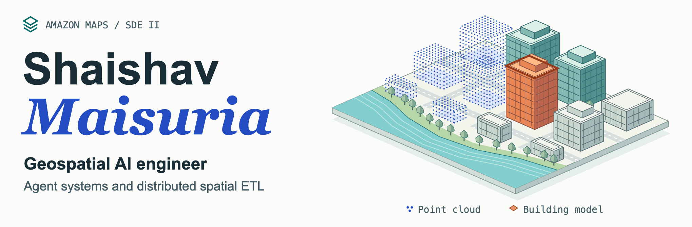
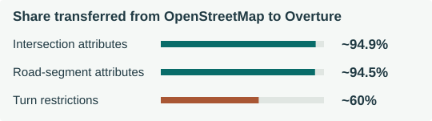

<h1>
  <picture>
    <source media="(max-width: 600px) and (prefers-reduced-motion: no-preference)" srcset="./assets/atlas-signature-mobile.svg">
    <source media="(max-width: 600px)" srcset="./assets/atlas-signature-mobile.png">
    <source media="(prefers-reduced-motion: no-preference)" srcset="./assets/atlas-signature.svg">
    
  </picture>
</h1>

I build **geospatial AI at Amazon Maps**. A model can draw a convincing sidewalk that connects to nothing. I design the agent tools and geometry checks that catch that mistake, and the distributed ETL pipelines that put spatial data to work on AWS.

[LinkedIn](https://www.linkedin.com/in/shaishav-maisuria/) · [Papers on Amazon Science](https://www.amazon.science/author/shaishav-m-maisuria) · [Watch my conference talk](https://www.youtube.com/watch?v=N96IdetD6CE) · [Résumé](https://drive.google.com/file/d/1Klni1VQr1xGMxMwY8ShntAT614evKUGY/view?usp=sharing)

##  MapScout

**[Best Demo Paper Award · ACM SIGSPATIAL 2026](https://github.com/vishal4c/vishal4c#awards)** 
With Vishal Kumar and Emre Eftelioglu.

How do you check a map edit before someone uses it for directions? In [MapScout](https://www.amazon.science/publications/mapscout-an-agentic-harness-for-map-editing-and-geospatial-data-labeling), agents use satellite imagery, OpenStreetMap and GPS traces to propose paths and labels. Topology and routing checks flag broken connections. A human editor makes the final call.

## First-author research

**[Transferring the Long Tail](https://www.amazon.science/publications/transferring-the-long-tail-composing-geometric-and-llm-based-stitching-for-cross-provider-map-migration) · IEEE Big Data 2026** 
Two providers can map the same junction differently. We use geometry and reachability to stitch edits onto the new map, then ask a multimodal agent to choose among candidate connections in the ambiguous cases.

**[Scalable Conflation for Maps Data Replay](https://www.amazon.science/publications/scalable-conflation-for-maps-data-replay-between-heterogeneous-geospatial-data-sources) · ACM SIGSPATIAL 2026, Industry Track** 
Moving a no-left-turn rule between basemaps is harder than copying a road attribute: every segment in the maneuver has to match. On the public benchmark, we transferred **about 60% of turn restrictions at 99% precision**.

## Engineering

**Distributed spatial ETL.** I work with Scala, Spark, Apache Sedona, Hadoop and AWS. In our [FOSS4G pipeline](https://talks.osgeo.org/foss4g-na-2026/talk/USHLU9/), Sedona joins OpenStreetMap-derived data, Overture and Natural Earth into regional GeoParquet partitions. Planetiler reads those files directly. There is no spatial database between the join and the finished vector tiles.

**AI infrastructure and developer tools.** I build agent harnesses and tools in Python and Java, work with Amazon Bedrock, and use AI in software development. Prompt and context engineering are practical design choices for me: what evidence does a tool give the model, what can it change, and what must code verify independently?

## Talks & service

| Venue | Contribution |
| :--- | :--- |
| State of the Map US | [How Amazon generates map tiles](https://openstreetmap.us/events/state-of-the-map-us/2026/how-amazon-generates-map-tiles/) · [Watch the recording](https://www.youtube.com/watch?v=N96IdetD6CE) |
| FOSS4G North America | [Distributed vector-tile generation](https://talks.osgeo.org/foss4g-na-2026/talk/USHLU9/) and [Routes to Safety](https://talks.osgeo.org/foss4g-na-2026/talk/NYKALL/), a hands-on open-data workshop |
| ACM SIGSPATIAL | [Agentic Map Data Maintenance](https://sigspatial2026.sigspatial.org/workshops.html), UMFM industry talk with Vishal Kumar and Li Xu · [GeoIndustry program committee](https://geoindustry.github.io/geoindustryworkshop2026/) |

Before Amazon, I worked on C++ point-cloud processing for edge computer vision and mixed reality at UNC Charlotte, where I also taught Java and algorithms as a teaching assistant. I earned my B.S. and M.S. in Computer Science there, joined Amazon in 2022, and became a Software Development Engineer II in 2025.
