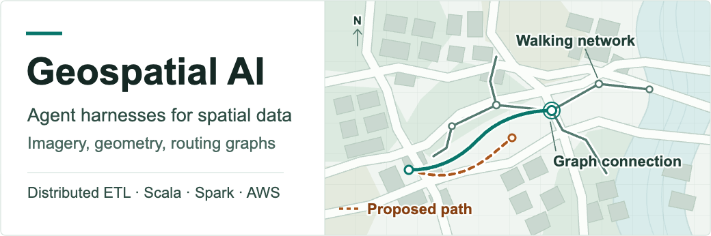

# Shaishav Maisuria

**Geospatial engineer at Amazon Maps.**

I build the data systems behind last-mile delivery maps. My work focuses on what happens when a map changes: how to preserve routing rules, reconnect road edits, and verify new ones.

[LinkedIn](https://www.linkedin.com/in/shaishav-maisuria/) · [Amazon Science](https://www.amazon.science/author/shaishav-m-maisuria) · [Résumé](https://drive.google.com/file/d/1Klni1VQr1xGMxMwY8ShntAT614evKUGY/view?usp=sharing)

<picture>
  <source media="(prefers-reduced-motion: no-preference)" srcset="./assets/hero.svg">
  
</picture>

## Selected research

- **[Road-network conflation](https://www.amazon.science/publications/scalable-conflation-for-maps-data-replay-between-heterogeneous-geospatial-data-sources)** · ACM SIGSPATIAL 2026. Transfer road attributes and turn restrictions when switching map providers.
- **[MapScout](https://www.amazon.science/publications/mapscout-an-agentic-harness-for-map-editing-and-geospatial-data-labeling)** · ACM SIGSPATIAL 2026 demo. Agents propose map edits, deterministic checks test them, and people decide what to accept.
- **[Transferring the long tail](https://www.amazon.science/publications/transferring-the-long-tail-composing-geometric-and-llm-based-stitching-for-cross-provider-map-migration)** · IEEE Big Data 2026. Reconnect road edits with geometry first; use a model to choose among candidate connections when rules alone fall short.

## Talks and workshops

- **[Distributed vector-tile generation](https://talks.osgeo.org/foss4g-na-2026/talk/USHLU9/)** and **[Routes to Safety](https://talks.osgeo.org/foss4g-na-2026/talk/NYKALL/)** · FOSS4G North America 2026, with Vishal Kumar.
- **[Agentic Map Data Maintenance](https://sigspatial2026.sigspatial.org/workshops.html)** · ACM SIGSPATIAL UMFM 2026, with Vishal Kumar and Li Xu.
- **[How Amazon generates map tiles](https://openstreetmap.us/events/state-of-the-map-us/2026/how-amazon-generates-map-tiles/)** · State of the Map US 2026, with Vishal Kumar.

## Engineering

- **Spatial data:** Distributed ETL with Scala, Spark, Apache Sedona, Hadoop, and AWS.
- **AI engineering:** AI-assisted development, prompt and context engineering, agent harnesses, tools, evaluation, and infrastructure.
